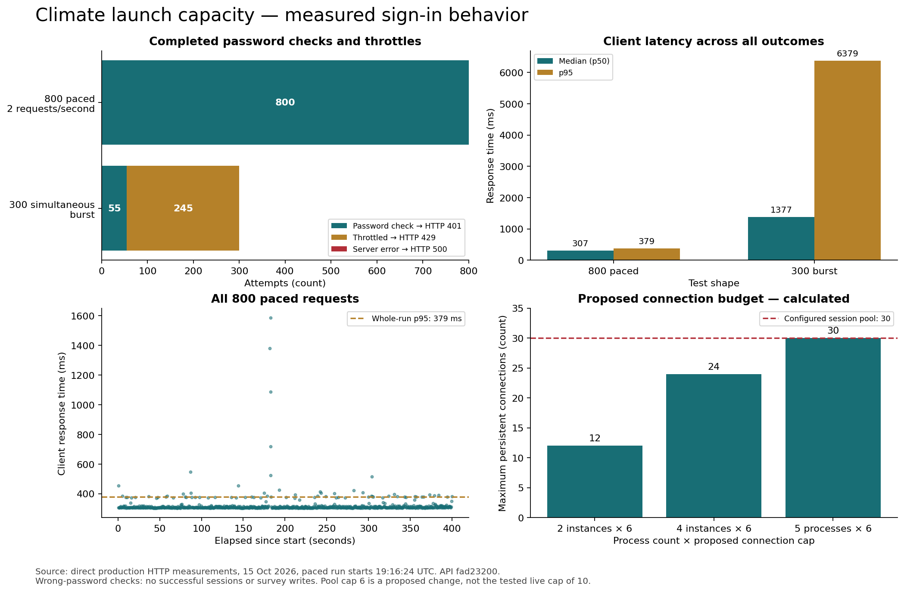

# 800-user launch: measured evidence, 15 October 2026

These are pre-deployment measurements of API `fad232008404aaca944d892834681379edea6924`.
The session pool was already raised to 30 by the operator; the deployed per-process
application connection cap was still 10. The proposed cap of six was not used in these runs.

## Direct HTTP measurements

- **Paced run:** 800 known-account, wrong-password attempts at two requests per second,
  starting 19:16:24 UTC. All 800 returned the expected HTTP 401. No HTTP 429, HTTP 500,
  or transport failures. Median 307 ms; p95 379 ms; maximum 1,587 ms. Duration 399.9 s.
- **Simultaneous burst:** 300 attempts, 55 HTTP 401 and 245 HTTP 429; no other statuses
  or transport failures. Median across all outcomes 1,377 ms; p95 6,379 ms. The JSON
  separately records latency for password checks and throttles.
- These runs exercise password verification for an existing account. They do **not**
  establish successful authentication, session behavior, survey writes, mail delivery,
  sustained maximum throughput, 800 distinct people, or 800 simultaneous active sessions.
- Absence of an application rejection log alone does not prove where a 429 originated.
  The load tool intentionally reports the status without assigning its source.

Raw per-request results: [paced run](paced-800.json), [burst](burst-300.json).
Exportable chart: [SVG](capacity-results.svg).

## Operational verification

- Live API: two minimum, four maximum instances, MaxConcurrency 12; 1 vCPU / 2 GiB.
- Startup log confirms effective default pool size 10 on the measured live release.
- Sending account `747814092517`, us-east-1: production SES access enabled, sending
  enabled, 100,000/day and 50/second quota. `timsint.com` verified and DKIM successful.
- `tims-transactional` exists, sending enabled; delivery and failure event destinations enabled.
- Production SMTP credentials authenticated over verified STARTTLS. A message carrying
  `X-SES-CONFIGURATION-SET: tims-transactional` was accepted for
  `success@simulator.amazonses.com`. This tests transport and SES acceptance, not the
  application's invitation dispatch or a human inbox.
- Twenty-five production alarms returned OK with actions enabled. Critical and warning
  topics each have two confirmed email subscriptions. This does not prove receipt of
  an alert in a human inbox.
- Scheduled database backup run `38735163943` succeeded on 15 October at 12:30 UTC.
  A historical restore was documented on 4 September; a current-backup restore rehearsal
  and an application rollback rehearsal are separate checks.
- Local real-browser walkthrough: 46 route visits across administrator and employee,
  all passed; no warnings, broken routes, or skipped visits. This was synthetic local data.

## Changes being validated

1. Default application pool 10 → 6: four steady-state processes request at most 24 of
   30 session slots. Explicit connection-string overrides retain their operator value.
   Five overlapping full pools would use all 30; rollout overlap still needs monitoring.
2. Database exhaustion filter also matches the observed `EMAXCONNSESSION` signature.
   CloudWatch TestMetricFilter matched both failure samples and ignored a healthy sample.
3. Authenticated survey readers/savers receive independent user buckets. Anonymous
   visitors retain the 60/minute address bucket, which still limits shared-network QR traffic.
4. Sign-in HTTP 429 copy tells readers to wait without falsely validating their credentials.

## Remaining launch gates

- Deploy the final tested revision and confirm the effective pool cap in startup logs.
- Complete the synthetic 800-user successful-login/save/resume/submit rehearsal.
- Confirm one real invitation reaches the intended inbox and its link completes the journey.
- Rehearse restore of a recent backup and application rollback in an isolated environment.
- Agree on a paced invitation rollout and a named person to monitor launch alerts.

Do not interpret the paced sign-in result as a guarantee for an unpaced 800-person spike.
