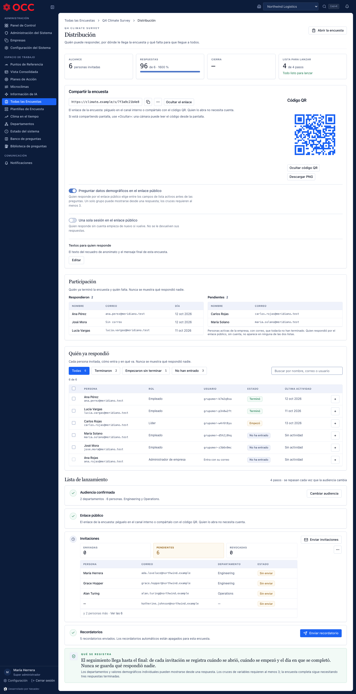

# What the API and the scripts can do that the screens cannot — 2026-10-22

**Pinned to `3356e917`** (origin/main = production, #613). Read-only audit; no production
call, no database query. Supersedes nothing — the first audit of this shape.

## Why this exists

The ESPH launch (13–21 Oct 2026, 865 credential emails over three surveys) and the EAGLE
launch ran almost entirely on `~/Desktop/TIMS-NEXA-Clima/*.sh|*.sql` and `scripts/*.mjs`,
because the screens could not do what was needed. This audit measures, route by route, what
the product can do through the API, what a screen actually reaches, and what an operator had
to do by script or SQL instead.

## Method

- **Every route** under `src/ClimateProject.Api/Endpoints` (236 `Map*` calls in 46 files) and
  the separate `services/tracking-api` solution, traced: route (file:line, roles) → web client
  function → **the component that calls it** → the router path that mounts that component →
  the nav that reaches it, per role. A client function with no calling component is counted as
  *unreached*, not as covered ("the DTO is not the screen").
- **The web side swept in reverse**: every router path, every client call matched to a server
  route, role guards against server policies, i18n copy checked against what the routes do.
- **Every kit script** catalogued by the operation it performs, the routes or SQL it uses and
  the guards it carries (§7).
- Seven read-only sweeps ran in parallel; every headline claim below was then re-read at its
  line by hand (marked ✔). Anything a sweep could not trace end to end is marked UNVERIFIED.
- **Screens rendered** with `npm run shot` and read. ⚠️ Instrument note: the shipped fixture
  `scripts/shot-fixtures/distribution-participation.json` **crashes the distribution page**
  (`TypeError … reading 'length'` in `DistributionView`) because its survey has no `userIds`,
  and it shows invitations with `sentAt` set — a state production can no longer produce. The
  render below uses a corrected fixture shaped like production
  ([`dist-prod-shape.fixture.json`](2026-10-22-frontend-api-gap-audit/dist-prod-shape.fixture.json):
  `userIds: []`, `credentialMode: per_survey`, every invitation `pending` with `sentAt: null`).

*`/surveys/s1/distribution`, es, production-shaped data. Read: "Enviadas 0 / Pendientes 6"
in amber and every row "Sin enviar" (G10); one "Enviar invitaciones" for the whole audience
(G9); a primary "Enviar recordatorio" that the API answers with zeros (G11); the roster's
USUARIO column is the account username, so one person reads "Entra con su correo" with the
checkbox disabled (G4); no code-mailed or sign-in column (G7); the credential mode is
nowhere on the page (G1). The "96 de 6 · 1600 %" tile is fixture data, but the screen does
not clamp it, and a public link can produce more responses than invitations.*

## 1. Headline

| | |
|---|---|
| Routes traced | 236 main-API + 15 tracking-service |
| Counted per domain (results/reports/exports/analytics) | 50 routes: 31 reached, 2 partial, 17 API-only. The other domains were traced row by row, not totalled |
| Whole surfaces no screen reaches | audit log (4), demographic snapshots (6), analytics insights (5), survey history/versions (4), notification templates (5), GDPR erasure/compliance/retention (3), 7 of 14 benchmark routes |
| Operations the October launches ran outside the product | **33** (§7) |
| …of which only SQL could do it | **4**: re-send one per-survey code, read a person's survey keys / last sign-in, delete a company, delete a person |
| …with no tooling at all | change a person's email |
| Live controls that cannot succeed | survey-invitation "Reenviar" (always 410), "Enviar recordatorio" (always 0) |
| Settings saved by a screen and read by nothing | 5 (AnonymousSurveys, SurveyFrequency, DataRetentionDays, MicroclimateEnabled, AiInsightsEnabled) |

## 2. Findings that touch live respondents (ESPH to 27 Oct, EAGLE to 28 Oct)

| # | Finding | Evidence |
|---|---|---|
| R1 | **Raw English server text on Spanish respondent screens.** Submit and autosave errors fall through to `error.message`; only 402 is translated. A respondent whose page outlives the close sees *"This survey is not currently accepting responses"*; also *"…reached its response limit"*, *"…does not allow partial responses"*, and the browser's *"Failed to fetch"*. ✔ | `SurveyRespondForm.tsx:715-719`, `:599-600`; server strings `SurveyResponseEndpoints.cs:1585`, `:555`, `:430`; also `EntryOutcomeCard.tsx:65`, `MicroclimateInvitationNextPage.tsx:261` |
| R2 | **Every respondent date is printed in UTC.** A close at or after 18:00 CR prints as the next day; the server closes at the true instant. Whether ESPH's or EAGLE's stored `end_date` crosses 00:00Z is UNVERIFIED (production data). | `SurveyRespondForm.tsx:1484,1845`; `SurveyInvitationPage.tsx:265,269`; `PublicRespondEntryView.tsx:72`; `MySurveysNextPage.tsx:240,347,399`; admin tiles use the browser zone (`launch.ts:304-307`) |
| R3 | **The credentials email never names its survey in the body** (subject only) and carries no close date. A person with two codes (ESPH: Clima + Teletrabajo) cannot tell them apart without the subject line. WIP exists unpushed on `the-email-names-its-survey` (`26e95c55`). | `CredentialsEmailComposer.cs` (`Subject()` vs body `copy.Subject`) |
| R4 | **The credentials email promises what per-survey mode cannot do**: *"Si los pierdes, pide a tu administrador que te envíe unos nuevos"*. True for shared accounts; impossible for a per-survey code (G2). | `CredentialsEmailComposer.cs:240,266`; `SurveyRosterPanel.tsx:411` |
| R5 | Microclimate invitation dead-end copy: *"pida a quien le invitó que le envíe una nueva"* — no resend client exists and re-inviting skips the person. | `MicroclimateInvitationEndpoints.cs:160-162` (no web client), `:308-328` |

## 3. The gap register

Size: S ≈ ≤1 day, M ≈ 2–3 days, L ≈ a week, each including tests and renders.
"Oct" = how the October launches did it.

### A. People and credentials — the reason a company or survey was ever deleted

**G1 — Credential mode (`shared` | `per_survey`) is invisible and unsettable.** ✔
- API: `PUT /admin/companies/{id}/settings` accepts `credentialMode` (`CompanyEndpoints.cs:264-277`); a survey freezes it at create (`SurveyEndpoints.cs:349,486`) and may override it then (`:337`). **There is no GET for company settings** (`CompanyEndpoints.cs:16-21` maps none) — three screens read settings by sending `PUT {}` (`useCompanySettingsModel.ts:64`, `useSuperCompanyDetailModel.ts:81`, `useSuperAnalyticsModel.ts:68`), so every page view is logged as a write.
- UI: the web settings type has no `credentialMode` (`companySettings.ts:4-12,30-45`); no screen shows or sets it, company or survey.
- Also: `PUT /surveys/{id}` with `settings.credentialMode` returns 200 and changes nothing (`ApplySettings`, `SurveyEndpoints.cs:1558-1631`, no branch, no refusal).
- Oct: `set-credential-mode.sh` (reads the mode by sending an empty PUT), `esph-0-empresa.sh`, `aprobacion-0-empresa.sh`.
- Impact: an admin cannot know which mode a company is in until an import's done-screen says so, after accounts exist. Size **S–M**. Risk: medium (only new surveys are affected).

**G2 — Re-send one person's per-survey code: no route.** ✔ 🔴
- API: `CreateInvitationsAsync` skips anyone already holding a credential for the survey (`alreadyCredentialed`, `SurveyDistributionEndpoints.cs:568-587`). The account-level resend refuses every account with no `users.Username` — exactly a per-survey person (`MassInviteEndpoints.cs:55-60,172-177`).
- UI: the roster disables the checkbox for such a person (`SurveyRosterPanel.tsx:411`).
- Oct: `reenviar-clave-*.sql` (`DELETE FROM survey_credentials … WHERE last_sign_in_at IS NULL`, must return 1 row) then `silence-activate-invite.sh --only <addr>`. Needed **3× in ESPH's first 24 h**; 2 run by SQL on 21 Oct.
- Needs: an endpoint that rotates the key's password and mails it, refusing if `LastSignInAt` is set (or with an explicit override), plus a per-person button on the roster. Size **M**. Risk: medium (credential rotation; one mail per click).

**G3 — Change a person's email: no route, no tooling.** ✔ 🔴
- API: `UpdateUserRequest` = Name, DepartmentId, ManagerId, IsActive, Demographics — **no Email** (`UserDtos.cs:32-40`). `users.email` is globally unique (`UserConfiguration.cs:42`; migration `20260731030029_InitialAuthSchema.cs:67-71`), so a mistyped address also blocks a re-import.
- Oct: nothing exists; ESPH was asked for corrected addresses (rvargasc@ nonexistent; full Gmail boxes) and nothing could be done with them.
- Needs: an email field on update, uniqueness check, and a decision on what happens to unused credentials (re-mail to the new address = G2's path). Size **M**. Risk: medium (identity; audit).

**G4 — The roster is built for shared mode.** ✔ (rendered)
- Its USUARIO column is the *account* username (`SurveyParticipationEndpoints.cs`, `users.Username`), so per-survey people read *"Entra con su correo"* — false; they sign in with a survey username (`roster.noUsuario`). Their checkbox is disabled.
- Its only working action, "Enviar recordatorio" = `resendCredentialsBatch` (`SurveyRosterPanel.tsx:166-206`), rotates shared-account passwords, **without a confirmation** (`ResendCredentials.tsx:42`).
- Size **S** (with G2 and G7). Risk: low.

**G5 — Remove one person.** ✔
- API: no DELETE for a user (or company, or demographic field). Deactivate (`IsActive=false`) exists and **the UI has it** (`AdminUsersView.tsx:742`, `SuperUsersView.tsx:516`); `ResolveAudienceAsync` filters on `IsActive` (`SurveyDistributionEndpoints.cs:1330-1352`), so deactivating is already the audience-safe removal. A per-survey survey's frozen credentials are not revoked by deactivation — UNVERIFIED whether sign-in checks `IsActive` for a survey key.
- Oct: 9 `delete-*.sql` files walking the FK graph, **≥7 runs** — most to clear test tenants whose leftover emails (global uniqueness) made a real import skip rows (616 of 617).
- Impact: the missing piece is not removal of a person but **deleting a test tenant**, plus making deactivation's effect on live codes explicit. Size **M** (tenant delete with guards) / **S** (copy + code revoke on deactivate). Risk: **high** for delete.

**G6 — Edit a person after import.** ✔
- API accepts Name, DepartmentId, ManagerId, IsActive, Demographics (`UserEndpoints.cs:240-268`).
- UI sends name, department, isActive only (`AdminUsersView.tsx:738-742`, `SuperUsersView.tsx:516-520`; `UpdateUserInput` has no demographics, `users.ts:30-35`). No manager, no demographics, no per-user detail screen, no single-user create (only invitations). The API cannot unset a department (`DepartmentId` null = leave alone), and the UI says so (`AdminUsersView.tsx:729-730`).
- Size **M**. Risk: low–medium (demographics feed segment reporting).

**G7 — Who received a code and who signed in: unknowable in product.** ✔
- `survey_credentials.CreatedAt` is read only by the GDPR export (`SubjectAccessExport.cs:187`); `LastSignInAt` is written at `AuthEndpoints.cs:113` and **read by nothing**.
- Credential sends are not persisted; a failed send deletes the credential and counts it in `credentialsNotSent` (`SurveyDistributionEndpoints.cs:613,632`), but the web type drops that field (`surveyDistribution.ts:198-214`), so **a failed credential mail is invisible to the admin**.
- Participation shows completed / started / not_started only (`SurveyParticipationEndpoints.cs:41`). "Mailed, never signed in" and "signed in, never started" look identical.
- Oct: `revisar-clave-aramirez.sql`; the status workbooks.
- Size **S–M** (expose two columns + persist send outcome). Risk: low.

**G8 — Bounces are invisible.** ✔
- No SES/SNS event handler, no bounce table (grep). The app stamps configuration set `tims-transactional` (`SmtpEmailTransport.cs:37,211-219`; `climate-project-api-prod-service.yml:357-358`), not the set the climate alarms watch. "Delivered" means SMTP accepted it.
- Oct: 10 of 865 bounced; read by hand from SQS `tims-bounce-debug` and **hardcoded** into `esph-auditoria-envio.py`. Suppression checked by `check-suppressed.sh`.
- Size **M–L** (infra + table + roster column). Risk: low.

### B. Sending

**G9 — Per-survey send over 100 recipients fails with a raw 400.** ✔
- API: `MaxCredentialBatch = 100` (`SurveyDistributionEndpoints.cs:95`, checked `:441-447`); shared mode caps at 500 (`:87`).
- UI: "Enviar invitaciones" always sends `{allTargeted:true}` in one request (`SurveyDistributionNextPage.tsx:465-472` → `useDistributionModel.ts:176-183`); no chunking; the 400 is shown in English. The intake wizard already chunks at 100 (`IMPORT_CHUNK_ROWS`), so the pattern exists.
- Oct: `esph-real-1-enviar.sh` — 9 slots of 100, one per 30 min, ~4 h, resumable, list reconciled against the audience.
- Needs: client- or server-side batching by `userIds`, progress, `credentialsIssued`/`credentialsNotSent` shown. Pacing for SES reputation is a separate decision. Size **S–M**. Risk: medium (mass mail).

**G10 — "Sin enviar" for every invitation, for ever.** ✔ (rendered)
- Nothing sets `SurveyInvitation.SentAt` since the invitation email was removed on 2026-10-19 (only microclimates set it, `MicroclimateInvitationEndpoints.cs:346`); `notificationsQueued` is the constant 0 (`SurveyDistributionEndpoints.cs:482`).
- Consequences on screen: "Enviadas" always 0; "Pendientes" always everyone, amber; the checklist step "Invitaciones" can never complete without a public link (`launch.ts:226-227`); the success toast says *"Se pusieron en cola {n} invitaciones"* (`invitationsQueued`) when nothing is queued.
- Size **S** (re-label the panel around what is true: credential minted / mailed / signed in — depends on G7). Risk: low.

**G11 — Two live controls cannot succeed.** ✔
- "Reenviar" on every non-completed row → always **410** with an English sentence (`SurveyDistributionEndpoints.cs:734-792`; offered `SurveyDistributionNextPage.tsx:562-567`).
- "Enviar recordatorio" → 200 with zeros by design (`:700-725`); the dashboard's low-participation card links to it (`AdminDashboardNextView.tsx:804`); the reminder line still says *"Salen solos cada {days} días…"* (`reminder.awaiting`, sweep deleted `InvitationReminderJob.cs:60-69`).
- "Texto de la invitación" edits `InvitationCustom{Subject,Message}`, which no composer reads, yet those fields are still in the publish translation gate (`SurveyContent.cs:100-123`).
- A draft shows "Enviar invitaciones"; the API answers 409 (`canDistribute` includes draft, `surveyInvitationCopy.ts:128-140`).
- Size **S**. Risk: low. (Admin screen, not respondent.)

### C. Import

**G12 — `/surveys/import` cannot import into a per-survey company, and cannot be retried.** ✔
- It always calls `submitIntakeRows(…, true)` → `withCredentials` (`climateWorkbook.ts:95,99`; `intake.ts:167`); the API refuses with 400 `credentials_not_available_per_survey` (`BulkImportEndpoints.cs:696-711`) **after** the company, fields and draft survey are already written (`climateWorkbook.ts:54-86`).
- Retry is impossible: preview treats an existing survey as "the same one" only if `NotificationSendInvitations && InvitationSendImmediately` (`ClimateWorkbookEndpoints.cs:130-131`), but apply creates it with `notificationSendInvitations:false` (`climateWorkbook.ts:84`) → *"ya existe una encuesta distinta"*.
- It sets the survey **active before** the invitation batches (`:123-129`), so a mid-run failure leaves a live survey with a partial roster. The script leaves a draft.
- Preview calls `response.json()` before `ok`, so a 403 (empty body) shows a `SyntaxError` (`climateWorkbook.ts:38-40`).
- Format coverage vs `import-climate-workbook.mjs`: the page needs the 5-sheet EMPRESA template, not the client's 4-sheet workbook; no link-only mode; no `number` fields; no `--skip-demographic`; 1..5 scale only; "Pregunta abierta" (singular) imports as Likert (`ClimateWorkbook.cs:170`); no randomise; no credential-mode declaration or read-back; audience = roster's departments, so non-roster people in those departments are included (the Teletrabajo 625-vs-240 failure).
- Size **M** (mode-aware path + retry + draft-first) / **L** (format parity). Risk: medium.

**G13 — Intake wizard offers a choice a per-survey company refuses.** ✔
- `ReviewStep.tsx:249` always offers both access radios; "credentials" → 400 shown raw, naming `POST /surveys/{id}/invitations`. The working radio ("Email an invitation") says *"Each person gets a link…"*, false in per-survey mode (accounts are created and nothing is mailed, `BulkImportEndpoints.cs:170-173,565-567`). Only the done screen tells the truth (`doneBodyPerSurvey`).
- Size **S** once G1's GET exists. Risk: low.

### D. Survey lifecycle

**G14 — Per-person targeting (`userIds`) has no UI.** ✔
- Accepted at create and update (`SurveyEndpoints.cs:561`, `:813-828`); no web write anywhere. **Duplicate drops it** — copies only `SurveyDepartmentTargets` (`SurveyEndpoints.cs:1166,1183`) — so a per-person survey becomes company-wide. Duplicate also drops `ServiceType` and `CredentialMode` (`SurveyDuplication.cs:60-88,190-218` — no `CredentialMode` anywhere in the file ✔); a null mode is read as `shared` (`SurveyDistributionEndpoints.cs:437`).
- `UpdateAsync` lets `userIds` and `serviceType` change on **closed or archived** surveys (`SurveyEndpoints.cs:638-649,759-774`).
- Oct: `create-teletrabajo.sh` (department targeting resolved to 625 instead of 240).
- Size **M**. Risk: high (who receives a survey).

**G15 — A survey created from a template is not anonymous.** ✔ 🔴
- `POST /survey-templates/{id}/use` builds the survey with no settings (`SurveyTemplateEndpoints.cs:629-646`; `SurveyTemplateInstantiation.cs:96-119`): `Anonymous=false` (`Survey.cs:60`), `CredentialMode` null (→ shared), mail flags on (`Survey.cs:128-129`), no "Created" audit row. The blank path forces anonymous (`SurveyEndpoints.cs:482`). The builder comment *"every survey built here is anonymous; the API defaults the same way"* (`SurveyBuilderNextPage.tsx:881-882`) is false for this path, and the path also discards the Service select and the partial/progress checkboxes (`wizardValues.ts:763-770`).
- Consequence: signed-out respondents can answer only anonymous surveys (`SurveyEndpoints.cs:477-481`), so a template-built survey's public link refuses them, and its identity promise differs from every other survey.
- Size **S**. Risk: **high** — anonymity is a promise to respondents. Whether any live survey was built from a template is UNVERIFIED (production data).

**G16 — Lifecycle actions that are API-only.** ✔
- Change the close date while live (allowed draft/scheduled/active, `SurveyStatuses.cs:140-143`) — no UI. Consequence: duplicating a closed survey yields a draft with past dates that **the UI can never launch** (`SurveyDuplication.cs:76-77`; Activate disabled past end, `SurveyDetailNextPage.tsx:258,400`), contrary to *"duplicate is the supported way to run a survey again"* (`surveys.ts:328-331`).
- Delete at 0 responses — `deleteSurvey` has no caller (`surveys.ts:502`). Oct: `delete-survey.sh`, `cleanup-test-*.sh`.
- Randomise, time limit, response limit, ServiceType after create — no UI. Oct: importer flags.
- Open now / move start (`open-survey-now.sh`), open the public link before start (`link-before-start.sh`, `accessRules.activeOutsideSchedule`) — no UI.
- Builder dates use the browser's zone, not the company's (`wizardValues.ts:716-717`).
- Reopen is impossible everywhere (closed → archived only) — by design.
- Size **S** each. Risk: medium for the date editor (schedule changes on a live survey).

**G17 — History and versions are API-only** (`SurveyHistoryEndpoints.cs:30-37`, no client). Size M. Risk: low.

### E. Company settings

**G18 — Five settings are saved by a screen and read by nothing.** ✔
- `AnonymousSurveys` (written `CompanyEndpoints.cs:256`, echoed `:292`, no reader; every survey is forced anonymous) — shown as *"Default anonymity… applies to new surveys"* (`CompanySettingsNextView.tsx:279-288`, `SuperCompanyDetailView.tsx:384-406`).
- `SurveyFrequency` (*"Four waves a year: Q1 in February…"*), `DataRetentionDays` (*"How long closed responses are kept"*; the retention job uses fixed periods, `RetentionCleanupJob.cs:58,67`), `MicroclimateEnabled` (SA still shows a switch, `SuperCompanyDetailView.tsx:443-452`), `AiInsightsEnabled`.
- Brand colour copy contradicts itself and the code: SA says *"Buttons and accents on the response screens"*, CA says *"Stored, but not applied to any screen yet"*; it styles no screen and **is** the email button colour (`EmailBranding.cs:111-114`), only on credential, mass-invite and distribution mail.
- Size **S** (copy or remove). Risk: low.

**G19 — Branding.** Logo upload is a permanently disabled button (`CompanySettingsNextView.tsx:431`); the logo is a same-origin path that must be committed under `web/public/brand/` and deployed; SA sees it read-only and has no timezone control; `GET /admin/companies/{id}` returns no branding (`CompanyDtos.cs:15-24`). Oct: `set-branding.sh`, `ship-eagle-logo.sh` (a code deploy per client logo). Size **S** (SA parity) / **L** (real upload needs an asset store). Risk: low.

### F. Reporting and compliance

**G20 — Per-person status report.** The data exists on screen (`/surveys/:id/distribution` roster, 3 states, `SurveyRosterPanel.tsx:210-230`) with **no download**. The SA-only workbook's PENDIENTES sheet lists only non-completers (`ResponseWorkbook.cs:105-106,163-178`); company admins have no download at all. Oct: `esph-estatus-descargar.sh` + `esph-estatus-excel.py`, twice on 21 Oct. Size **S** (roster export in the client's format). Risk: personal data — a download of who has not finished, scoped to admins.

**G21 — Audit log has no screen** (`AuditEndpoints.cs:67-74`, 4 routes, company-scoped). Size M. Risk: low.

**G22 — GDPR erasure has no screen, yet the privacy page promises it.** `POST /gdpr/erasure` (`GdprEndpoints.cs:86`), compliance report (`:87`), retention cleanup (`:88`) — no client; `ErasureRequestPanel` lives only in the unrouted `PrivacySettingsPage.tsx`. The employee-facing page says the organisation's administrator carries it out (`privacy.next.erasure.text`). Size **M**. Risk: **high** (irreversible; needs a confirm flow).

### G. Microclimates, action plans, tracking

- **G23** Microclimate invitations: invite is switched off (`invitationsOffered.ts:30`); resend / revoke / reinstate have no client (`MicroclimateInvitationEndpoints.cs:160-162`); the card is read-only, first 8 rows. Draft content cannot be edited (only `{status}` is sent); a draft cannot be discarded. Admins never see seat usage until respondents hit 402.
- **G24** Action plans: title, description, **due date**, tags not editable after create; no owner on create; no progress history after reload (no GET); no delete route (the comment at `ActionPlanEndpoints.cs:49` says there is). With tracking on, the sidebar hides `/action-plans` but four other entry points still lead there.
- **G25** Tracking: a node leader may create plans and add involucrados (`PlanAccessHandler.cs:38-43`), but the people/node pickers are admin-only (`TrackingPickerEndpoints.cs:19-21`), so leaders type raw external ids and cannot add people; hallazgo linking is free text; export only for admins. `MapOpenApi()` is exposed unconditionally in production (`services/tracking-api/.../Program.cs:130`).
- Templates: `createMicroclimateTemplate`, `createActionPlanTemplate` exist with no caller; survey template PUT/DELETE have no UI.

### H. Roles and navigation

- **G26** The `employee` respondent gate (`RequireAuth.tsx:86`, `respondentSurface.ts:5-9`) redirects every page except `/dashboard`, `/surveys/:id/respond`, `/tracking/mis-tareas` — but **every notification email footer** links to `/settings/notifications` (`NotificationEmailComposer.cs:42,59`), and *Mis tareas* links each task to `/tracking/planes/:id` (`MisTareasNextPage.tsx:271`). Both bounce to the dashboard.
- **G27** Supervisor has no sidebar (`AdminLayout.tsx:104,114`), so no UI path to profile, settings, notifications or *Mis encuestas*.
- **G28** Plan-due nudges tell non-admin owners to *"Registra un avance o cambia la fecha"* (`ScheduledNotificationCopy.cs:86-91`); only admins can (`ActionPlanEndpoints.cs:409,502`).
- **G29** Login help *"Pida a quien administra la plataforma… que la restablezca"* — no admin UI resets an email-login account; `POST /auth/admin/reset-credentials` (`AuthEndpoints.cs:46`) has no client.
- **G30** ~100 admin handlers render `err.message` raw (`authFetch.ts:121`), so API English reaches Spanish admins systemically. ~213 `tracking.*` keys in `en.json` are Spanish.

## 4. Dead surface (no caller in routed code)

Client functions: `deleteSurvey`, `deleteSurveyTemplate`, `getSurveyResults`, `getSurveyStatistics`,
`getSurveyRealTimeStats`, `createActionPlanTemplate`, `createMicroclimateTemplate`, all five
notification-template functions, `listCompanyNotifications`, `dispatchNotification(s)`,
`processDueNotifications`, `getBenchmarkTrend`, `getIndustryBenchmarks`,
`listBenchmarkCategories`, `validateBenchmark`, `importBenchmarks`, `getQuestionBankMetrics`,
`parseIntakeWorkbook`; reachable only from unrouted legacy pages: `bulkImportUsers`,
`readConsentRecord`, `compareBenchmarks`, `updateQuestionCategory`.

API-only surfaces with no client at all: analytics insights (5), demographic snapshots (6),
audit (4), survey history (4), GDPR erasure/compliance/retention (3), `POST /surveys/bulk`,
`POST /microclimates/bulk`, question-bank analytics/usage/bulk/import/delete/variations,
benchmark backfill. Unrouted page trees still in `src`: `microclimates/pages/*`,
`action-plans/pages/*`, `tracking/pages/*`, `surveys/pages/*`, `questions/pages/*`.

Sector (industry) benchmarking, which `docs/decisions/benchmark-analytics-endpoints.md:46-60` says the
client contract depends on, has routes and client functions but no screen; the screen recomputes compare and trend in
the browser. The results screen reads the unaudited `/analytics`, while the audited
`/results` has no caller (`SurveyResultsEndpoints.cs:71-85`).

## 5. Privacy: what the code enforces, against what the repository's guidance says

These are **rulings, not defects** — but the guidance has drifted from them, and one
reach may be wider than the ruling.

- **Single-segment floor is 1** since the client's 2026-10-15 ruling, quoted in the code
  (`SurveyResultsPrivacy.cs:118-147`, `MinimumSingleSegmentRespondents = 1`). The floor of 3
  still holds for crosses (`MinimumSegmentRespondents`), the whole survey
  (`MinimumRespondents = 3`) and public share links (re-floored to ≥3 with complement
  withholding, `PublicReportDocument.cs:654-688`). **`CLAUDE.md` ("a suppressed segment must
  never yield a number") and `docs/decisions/privacy-floor-is-three.md` still describe the
  old rule.**
- **The same floor reaches leaders and supervisors.** `DashboardEndpoints.cs:109`
  (`DepartmentCountFloor = MinimumSingleSegmentRespondents`) and `:1014-1029`: a one-person
  team's climate is shown to its leader, and in the leader's export. The ruling's text is
  about department and demographic *results*; the justification recorded in
  `PublicReportDocument.cs:715-716` is administrators reading their own tenant. **Whether the
  ruling was meant to reach a leader reading their own one-person team is not recorded.**
- **Verbatim open text** is returned to super admins in the response workbook
  (`ResponseExportEndpoints.cs:231,255-256`), ruled 2026-10-16 in
  `docs/decisions/who-may-see-an-individual-answer.md` §6; company admins are refused (`:87`).
  `CLAUDE.md` still says *never*.
- **Anonymous responses carry a stable HMAC(survey, user) `session_id`**, never cleared on
  completion (`SurveyResponseEndpoints.cs:573-574,755-767`; `SurveyResumeSession.cs:59-72`),
  with a key that falls back to `TrackingJwtSecret`. Whoever holds the key and the database can
  attribute anonymous answers. Two strings say otherwise: *"no column to join on"*
  (`ResponseExportEndpoints.cs:28-31`) and the RESUMEN note *"no se guardó quién respondió
  cada fila"* (`ResponseWorkbook.cs:149`).
- Two endpoints report a floor they did not apply: `/real-time-stats` applies 1, reports 3
  (`SurveyResultsEndpoints.cs:335,371`); the team dashboard reports 1 when 3 suppressed it
  (`DashboardEndpoints.cs:986-988`). Misleading, not leaking.
- Public share links fail closed (one uniform 404, `ReportShareEndpoints.cs:258-288,381-389`). SUSPECTED: the whole-survey floor and per-question distributions are taken from the stored document, not re-checked at read; AI-insight free text is published; a missing company row would 500 rather than 404 (`:347-351`).

## 6. Things this audit did not measure

- Production values: ESPH/EAGLE `end_date` instants (R2), whether any live survey came from a template (G15), whether Vercel prod sets `VITE_TRACKING_API_BASE_URL`.
- Whether a deactivated person's per-survey key still signs in (G5).
- Layout of screens other than the distribution page — every other row is traced in code, not rendered.

## 7. Operations the October launches ran outside the product

Catalogue of `~/Desktop/TIMS-NEXA-Clima` and `scripts/*.mjs` (infra, DNS, deploy and secret
scripts excluded). "SQL" = no API exists.

| # | Operation | Done by | Route(s) / SQL | SQL? | Gap |
|---|---|---|---|---|---|
| 1 | Create company with domain, tz, language, bands | `*-0-empresa.sh`, `create-eagle-company.sh`, importer | `POST /admin/companies`, `PUT …/settings` | no | partly in UI |
| 2 | Set credential mode before any survey | `set-credential-mode.sh` + 4 others | `PUT …/settings` (read via empty PUT) | no | G1 |
| 3 | Set / verify logo and colours | `set-branding.sh`, `ship-eagle-logo.sh` | `PUT …/settings` + a code deploy | no | G19 |
| 4 | Demographic fields + departments | `create-eagle-demographics.mjs`, importers | `/admin/demographic-fields`, `/admin/departments` | no | in UI |
| 5 | Import climate workbook (Identificada, randomised, skip columns, CR window) | `import.sh` → `import-climate-workbook.mjs` | bulk-import ×100 + `POST /surveys` | no | G12 |
| 6 | Add a roster to an existing company without mailing | `import-teletrabajo.*` | bulk-import ×100 | no | G12/G13 |
| 7 | Survey targeted at named people | `create-teletrabajo.sh` | `POST /surveys {userIds}` | no | G14 |
| 8 | Survey from a saved/corrected payload | `create-eagle-corrected.sh`, `create-survey-from-payload.sh` | `POST /surveys` | no | G16 (scale order, optional last question) |
| 9 | Question library load | `import-question-library.mjs` | per-item POSTs | no | no bulk |
| 10 | Window as UTC instants, read back | `esph-real-0`, `rehearsal-open-now.sh` | `PUT /surveys/{id}` | no | G16 |
| 11 | Open now / move start | `open-survey-now.sh` | `PUT /surveys/{id}` | no | G16 |
| 12 | Public link live before start | `link-before-start.sh` | `PUT …/distribution` | no | G16 |
| 13 | Create QR without revoking an existing one | `create-public-link.sh` | `PUT …/distribution` | no | in UI (refusal guard is script-only) |
| 14 | Silence survey mail | `silence-activate-invite.sh` | `PUT /surveys/{id}` | no | moot since #606 |
| 15 | Activate | `activate-and-invite.sh` | `PUT …/status` | no | in UI |
| 16 | Invite a subset ≤100, mint codes | `silence-activate-invite.sh --only` | `POST …/invitations {userIds}` | no | G9 (subset exists in UI, by hand) |
| 17 | Paced bulk send, resumable, list-reconciled | `esph-real-1-enviar.sh` | participation + invitations | no | G9 |
| 18 | Send a test credentials email | `send-test-credentials.sh` | bulk-import (creates a real user) | no — but the user can only be removed by SQL | G5 |
| 19 | End-to-end per-survey proof | `test-per-survey-credentials.sh` | — | no | — |
| 20 | **Re-send one per-survey code** | `reenviar-clave-*.sql` + `--only` | `DELETE FROM survey_credentials` | **yes** | **G2** |
| 21 | **Read one person's keys / last sign-in** | `revisar-clave-aramirez.sql` | `SELECT survey_credentials ⋈ users` | **yes** | **G7** |
| 22 | Per-person status report | `esph-estatus-*` | `GET …/participation` | no | G20 |
| 23 | Delivery / bounce audit | `esph-auditoria-envio.py` | SQS by hand | AWS | G8 |
| 24 | Suppression check | `check-suppressed.sh` | `sesv2` | AWS | G8 |
| 25 | Invitation rows / sent_at | `check-invitations.sh`, LAUNCH.md SQL | `GET …/invitations`; SELECT | partly | G10 |
| 26 | Question order / randomise check | `check-survey-order.sh` | `GET /surveys/{id}` | no | — |
| 27 | Verify live survey against payload | `verify-eagle-live.mjs` | GETs | no | — |
| 28 | Excel list vs audience reconciliation | `esph-listas.mjs`, `esph-real-1` | participation | no | G9 |
| 29 | Inventory before cleanup | `list-surveys.sh`, `inventory-before-delete.sql` | GETs; SELECT | partly | G5 |
| 30 | Delete / archive a survey | `delete-survey.sh`, `cleanup-test-*.sh` | `DELETE /surveys/{id}` | no | G16 |
| 31 | **Delete a company and everything under it** | 9 `delete-*.sql`, ≥7 runs | FK-closure `UPDATE … SET NULL` + `DELETE` | **yes** | **G5** |
| 32 | **Delete one person** | only via #31 | — | **yes** | **G5** |
| 33 | **Change a person's email** | nothing | — | no tooling | **G3** |

Guards the scripts carry that the product lacks: dry-run by default; `--only` single-address
scope; refusal when the recipient count exceeds the per-survey cap; refusal when the mode is
not per-survey; read-back of the frozen mode; refusal if a key was already used
(`last_sign_in_at IS NULL`, exactly one row); refusal to regenerate a printed QR; the
`--expect` headcount; accent/case-duplicate department refusal; list-vs-audience
reconciliation before mailing.
